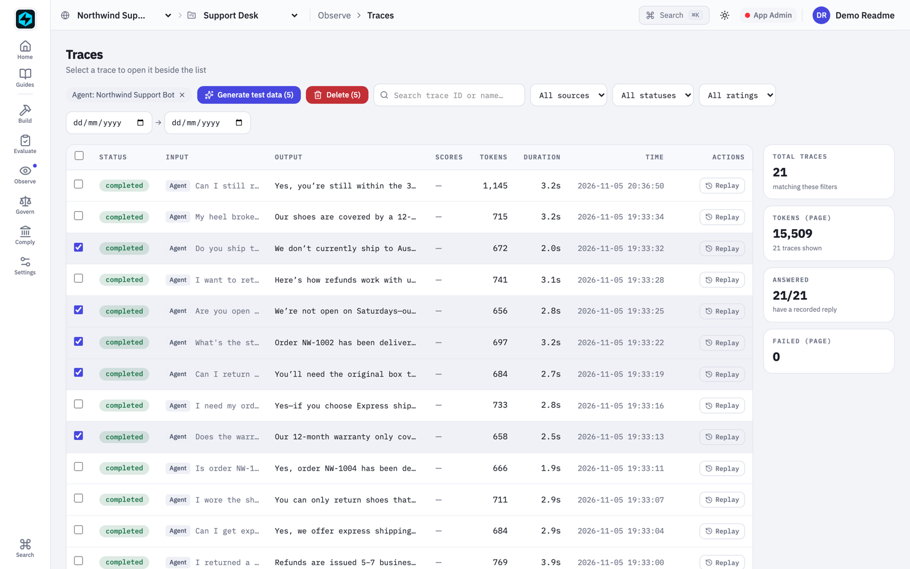
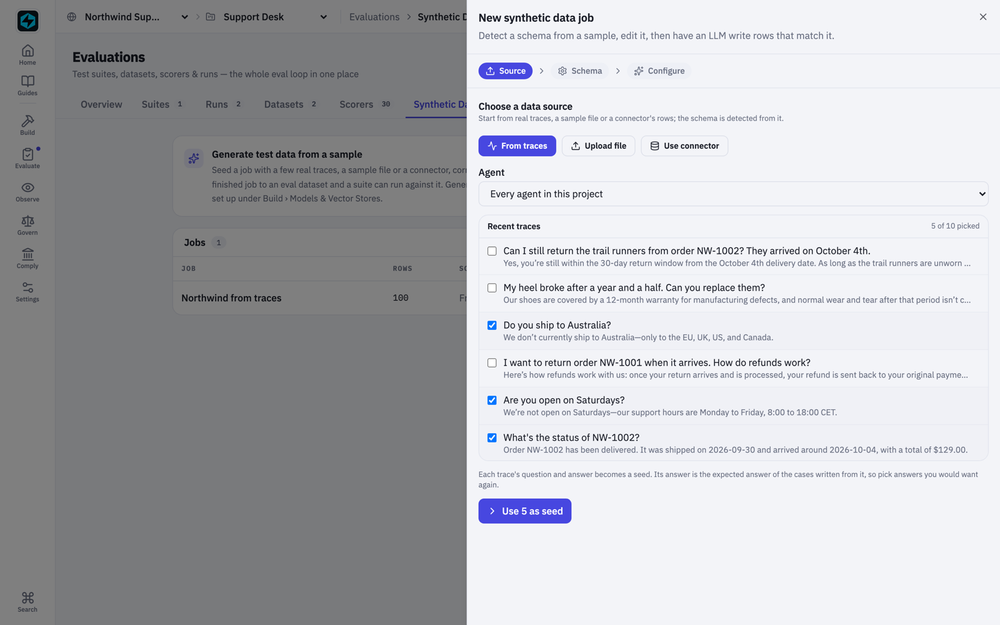
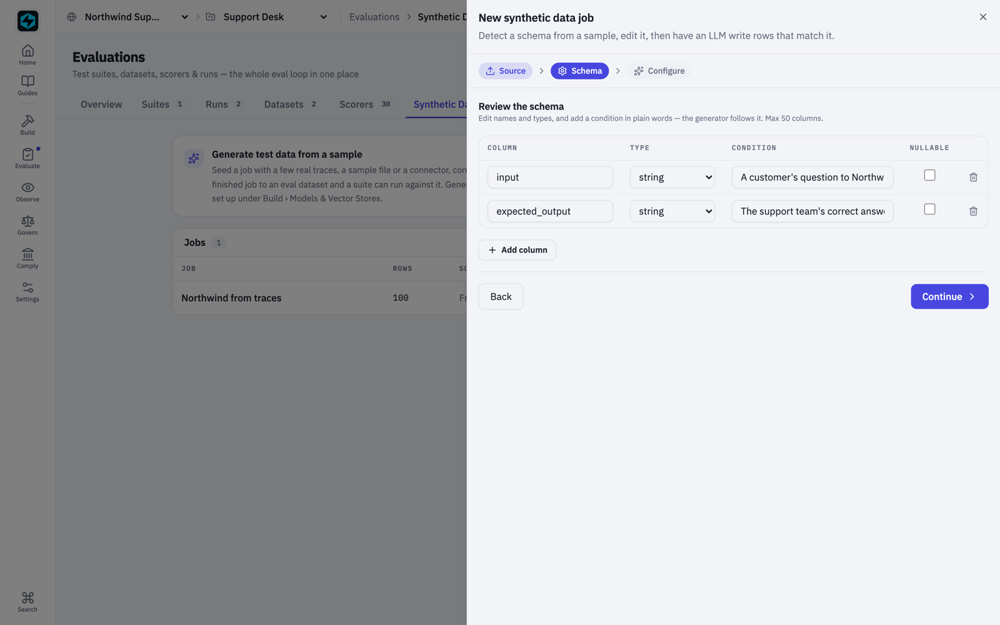
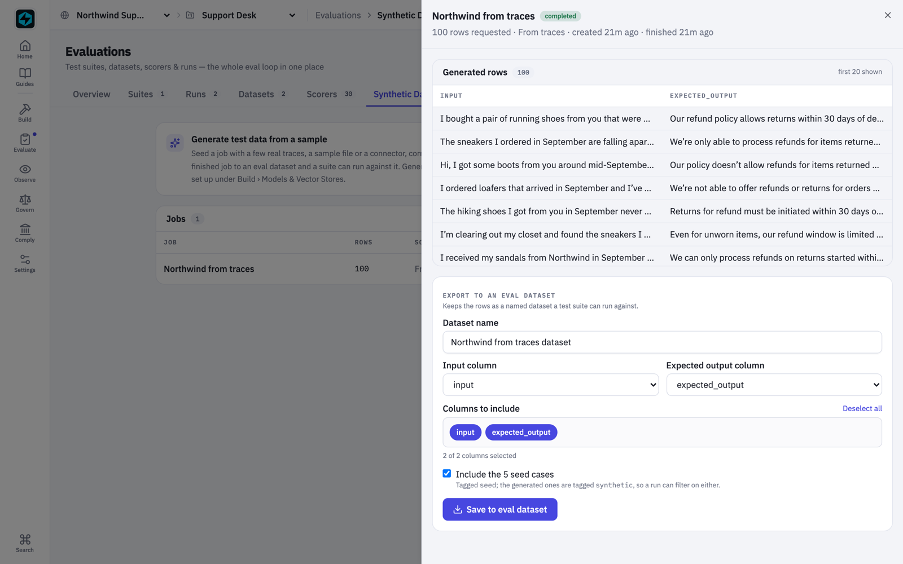
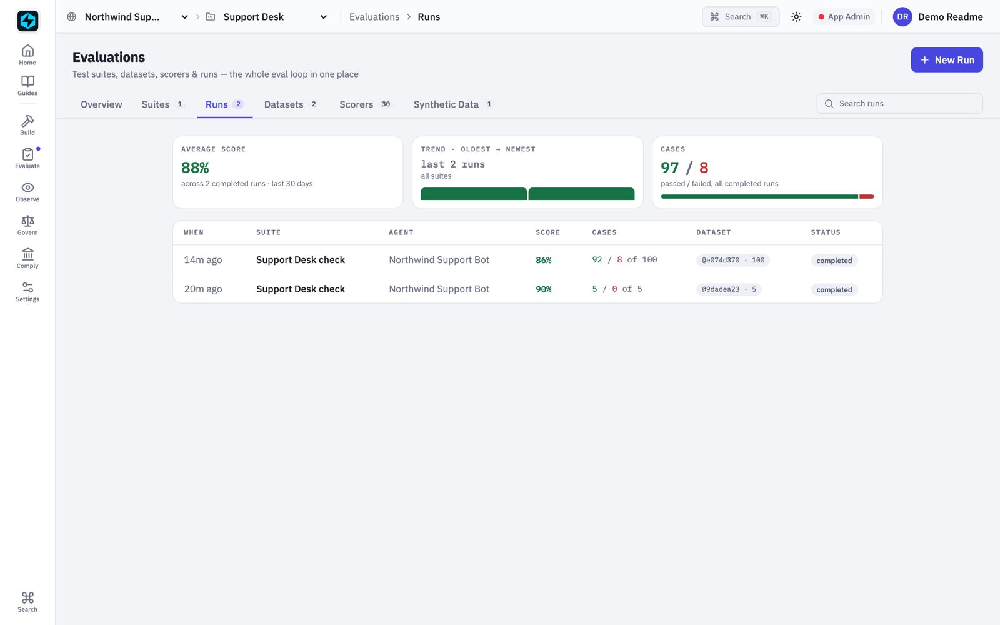
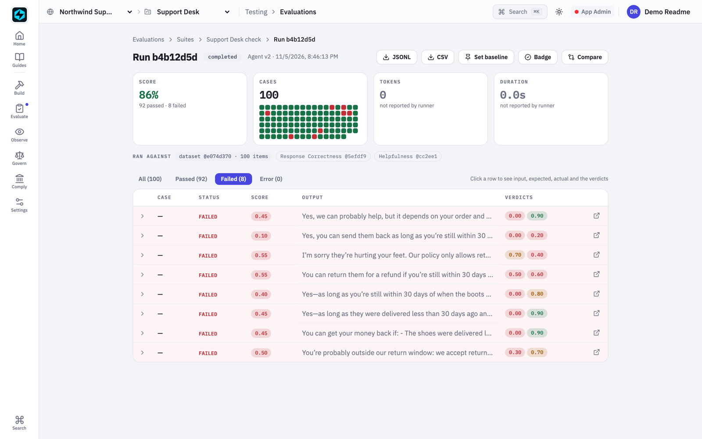

Ask a team shipping an AI agent how many test cases it has. Usually someone wrote ten by hand, and the set has not grown since. Production has no such limit. Customers ask the same thing in a hundred ways, in other languages, about edge cases nobody wrote down.

Synthetic data closes that gap: give a model a few real examples and let it write many more in the same shape. The question is where the examples come from. On FastAIAgent Enterprise, they come from the traces your agents already send to the plane.

## Start from what really happened

Every connected agent reports its runs as traces: the question it was asked and the answer it gave. Those are the best examples you have. On the Traces page, tick the ones you want and choose **Generate test data**.

The wizard opens with those traces already picked. Each one becomes a seed row: its question as the input, its recorded answer as the expected answer. That makes the choice matter, so the picker shows each trace's feedback and scores. Pick answers you would want again.

## Say what to vary, in plain words

The plane reads the shape of the seeds, a question and its answer, and takes instructions per column. Ours: *a customer's question to Northwind, an online shoe store; vary the tone; refunds past the 30-day window; no order number; one in Spanish; never a real name.*

That condition is the main lever. On a first attempt we left out "shoe store", and the model drifted to rugs and candles. Name the domain and the cases stay on it.

## A hundred cases in half a minute

Generation runs in the background on the model already configured for the project, so no data goes to a service you did not choose. In this run, 100 cases took 34 seconds: refunds past the window, missing order numbers, frustrated customers, four in Spanish. The seeds and every generated row are encrypted at rest under the customer's own key. The model is told not to reuse personal details from the examples, and any row that copies a seed is dropped.

One click saves them as an eval dataset. The real cases are tagged `seed` and the new ones `synthetic`, so a run can use either.

## Run it where the agent runs

The plane never runs agent code. The suite goes to a registered runner in the customer's environment, which executes the agent with its real tools and sends the results back. The plane scores every case centrally, here with a correctness judge and a helpfulness judge.

The five real questions passed, as they would: their expected answers are the agent's own. The hundred found eight failures the seed set never had.

## What the hundred found

All eight are refund questions about the 30-day window. In most, the customer says the shoes arrived in September, and the agent replies "yes, as long as you're still within 30 days". It never works out that September is already past the window: it does not know today's date.

The same mistake was already in production. Asked on 5 November about shoes delivered on 4 October, the agent said they were still inside the window. No one had written that test, because no one had thought of it. The fix is a design decision: give the agent the date, or a tool that checks eligibility. Whichever the team picks, these hundred cases now gate it.

## The honest edges

The generated expected answers are a model's best reading of the policy, so read them before you rely on them. And pick seeds whose answers are right: each one becomes the standard its cases are held to.

## Tested, not assumed

Building this at a hundred real cases found problems no small test had shown. A job could read "completed" with no rows. Only three of five seeds reached the model. Seed text sat unencrypted. And cases written in the console reached the agent as raw JSON. All of it is fixed in release 0.19.6.

How does your team grow its test set today: by hand, or from what production already tells you?
