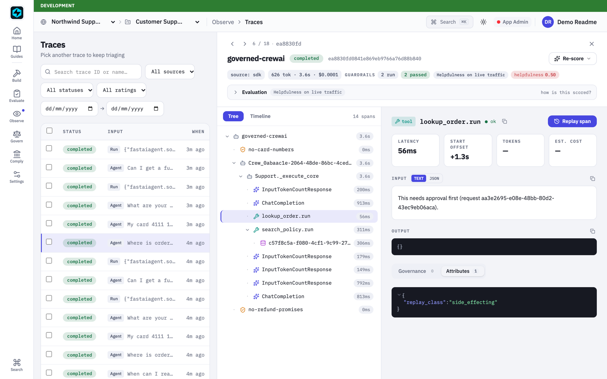
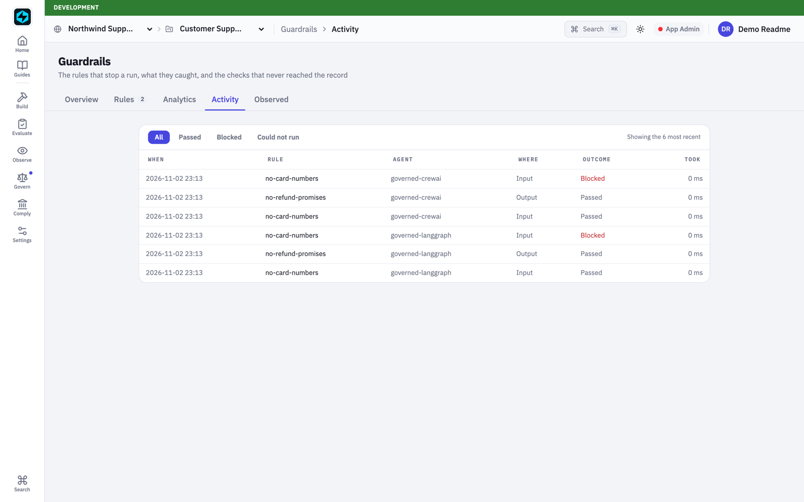
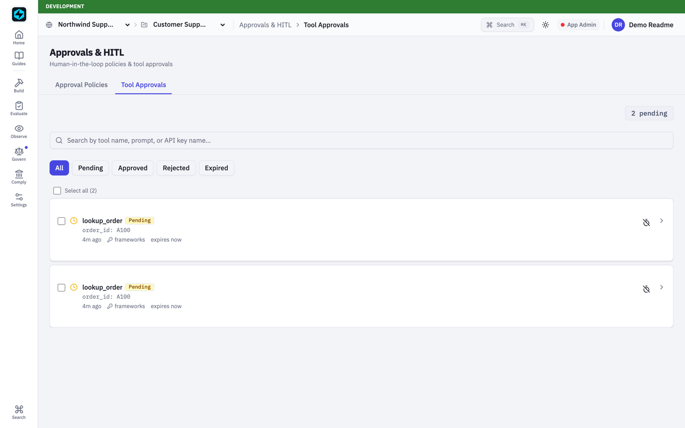
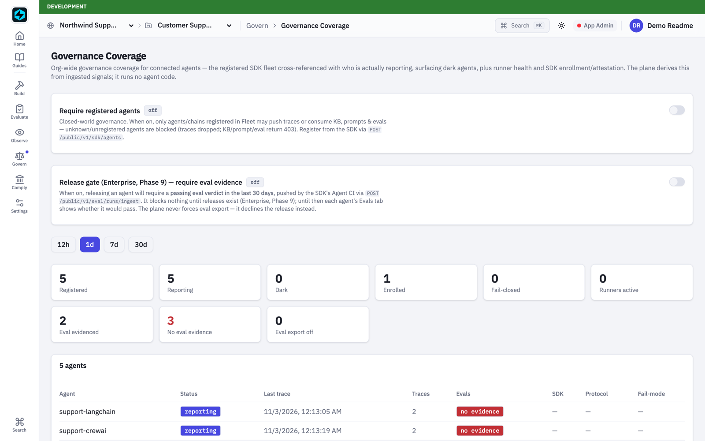
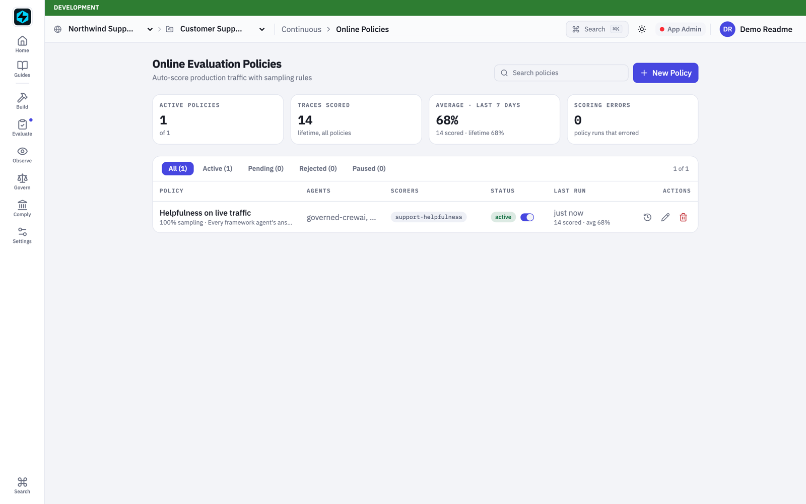

Most teams building agents have already picked a framework. The support bot is a LangGraph graph, the research assistant is a CrewAI crew, the RAG pipeline is a LangChain chain. Then the governance questions arrive. Which agents are running? Which prompt version produced that answer? Who stopped the one that promised a refund?

The usual answer is "rewrite it on our platform". Nobody wants to hear that.

FastAIAgent Enterprise takes the other route. The plane runs no agent code. Your agent keeps running in its own framework, in your environment, and connects to the plane in one of two ways.


## Observe: nothing from us installed

Point a standard OpenTelemetry exporter at the plane, name the service after the agent, and register that name once. Add the framework's OpenInference instrumentor and you're done. Every LLM call, tool call and retrieval arrives as a span under one named run.

```python
# A LangGraph agent. Stock OpenTelemetry, no fastaiagent package.
provider = TracerProvider(resource=Resource.create({"service.name": "support-langgraph"}))
provider.add_span_processor(BatchSpanProcessor(OTLPSpanExporter(
    endpoint=f"{PLANE_URL}/public/v1/otlp/v1/traces", headers={"x-api-key": API_KEY})))
LangChainInstrumentor().instrument(tracer_provider=provider)

with tracer.start_as_current_span("agent.support-langgraph") as root:
    root.set_attribute("input.value", question)
    root.set_attribute("fastaiagent.prompt.slug", "support-system")   # links the prompt version
    root.set_attribute("fastaiagent.prompt.version", version)
    answer = agent.invoke({"messages": [("user", question)]})["messages"][-1].content
    root.set_attribute("output.value", answer)
```

Three plain HTTP calls cover the rest:
- the system prompt comes from the plane's registry and the run is linked to that prompt version;
- the knowledge base is searched from inside a framework tool, with the plane's full retrieval pipeline;
- end-user feedback lands on the trace.

The plane then works on those traces with no code on your side. It scores them with online evaluation policies, turns them into eval cases, and replays them with a different prompt.



## Govern: the SDK as a library

When the plane must decide something at run time, add the fastaiagent SDK. You don't adopt its runtime; the framework still runs the agent. You call the SDK around the framework.

```python
# A CrewAI crew, unchanged. The plane's rules run around it.
fa.connect(api_key=API_KEY, target=PLANE_URL)
agent_id = fa.Agent(name="governed-crewai", system_prompt=system,
                    llm=fa.LLMClient(provider="openai", model="gpt-4o-mini")).push().agent_id
fa.enable_otel_capture()
CrewAIInstrumentor().instrument()

def answer(question: str) -> str:
    for rail in fa.plane_guardrails_for_agent(agent_id):   # rules written in the console
        verdict = rail.execute(question)
        fa.emit_guardrail(tracer, name=rail.name, position="input", checks="input",
                          passed=verdict.passed, action_taken=verdict.action_taken)
        if verdict.action_taken == "blocked":
            return f"Sorry, I can't help with that here. ({verdict.message})"
    return str(Crew(agents=[support], tasks=[task]).kickoff())
```

**Guardrails written in the console run in your process.** A rule that keeps card numbers out of the model stopped both a LangGraph agent and a CrewAI agent at the input, before any model call, and the verdict is on the record.



**Tool calls wait for a person.** An approval policy on `lookup_order` held both agents' order lookups. The plane records the pending request and your application collects the decision.



**Eval runs become evidence.** `fa.evaluate` takes any function, so it runs on a LangGraph graph or a CrewAI crew. A run that goes through the CI gate is recorded against the agent as evidence.

## What the platform team sees

All five agents, across three frameworks and both lanes, are registered and reporting. None is dark.



Their production answers are scored continuously, the same way for every framework.



## Tested, not assumed

Every screenshot here comes from a real run: LangChain 1.4.8, LangGraph 1.2.19 and CrewAI 1.15.34, real model calls, a real plane. Testing it this way also found a bug no unit test had: on long CrewAI runs the plane kept a child span's output as the agent's answer. It's fixed and released.

The edges are honest. Checkpoints and pause-and-resume belong to your framework's own runtime. Everything the plane offers around an agent works with the agent you already have.

If your agents live in LangChain or CrewAI and your governance lives in spreadsheets, I'd like to hear how you're closing that gap.
